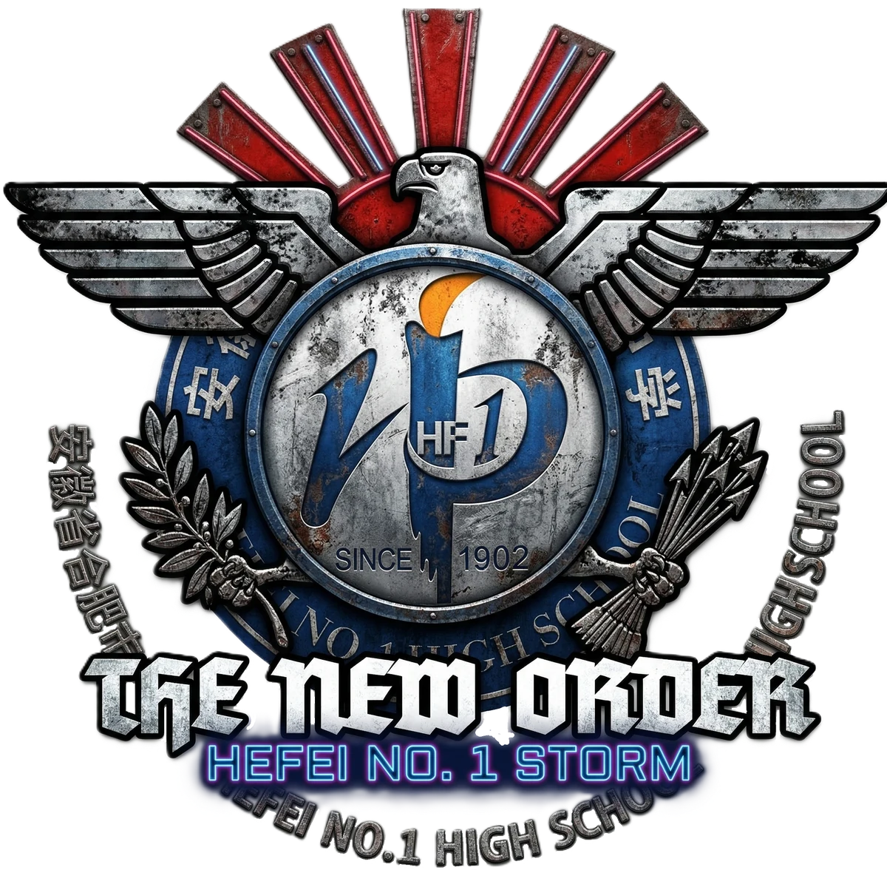
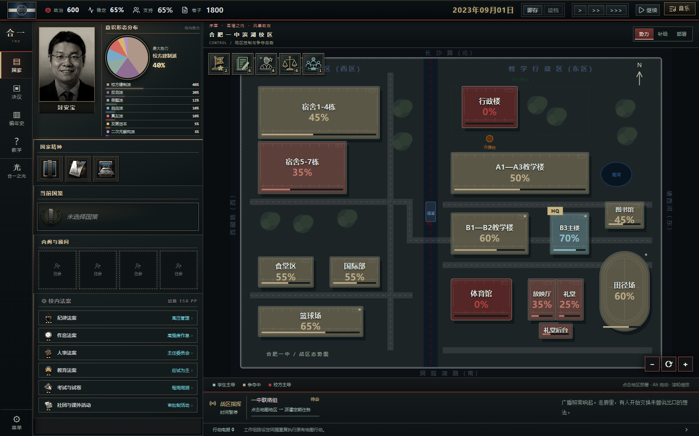
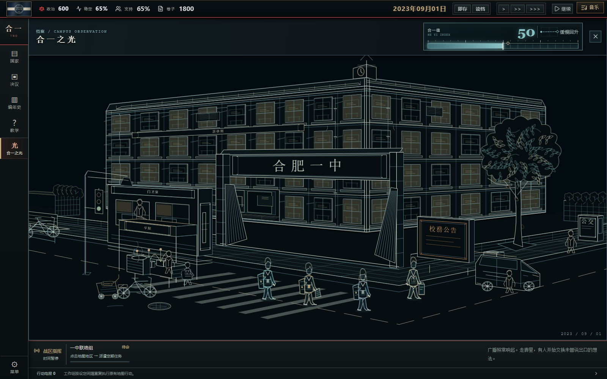
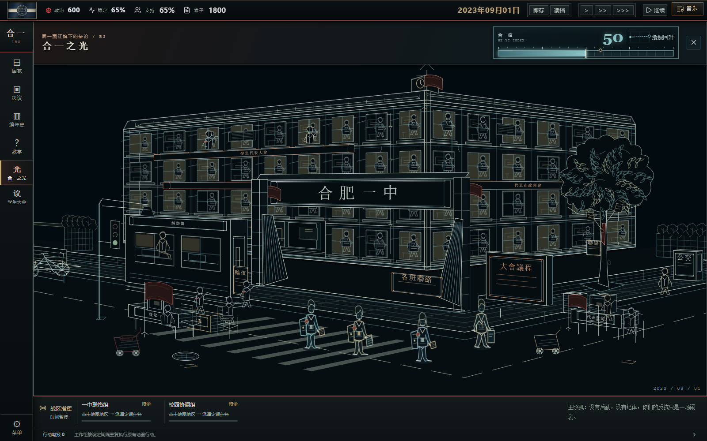
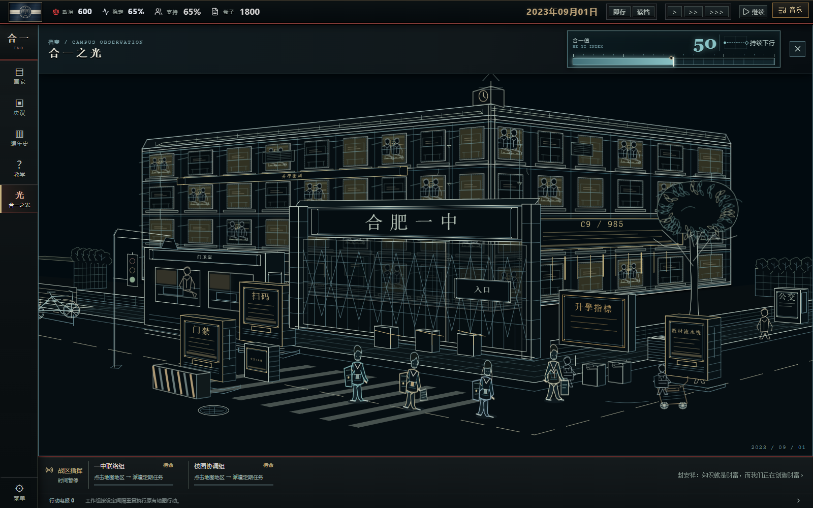
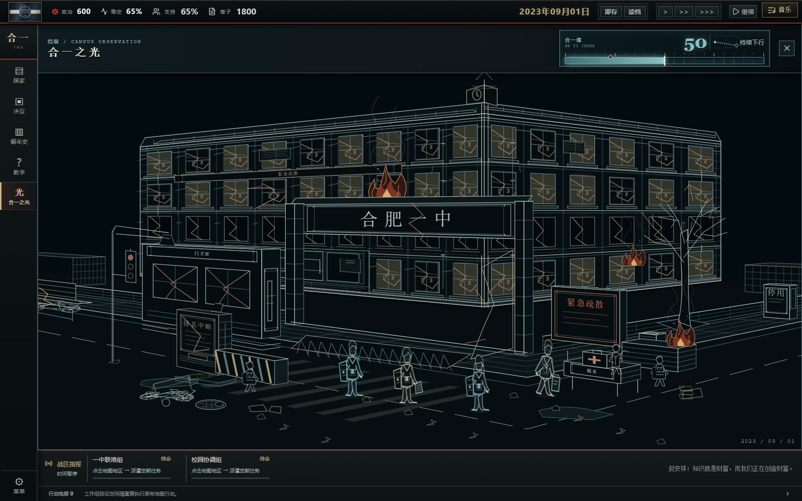

<h1 align="center">TNO：合肥一中风云</h1>

<b>THE HEFEI ORDER</b> 重拾民主，再塑合一。

---

2023年秋，合肥一中滨湖校区。

课表还贴在走廊里，卷子还在一摞摞地发。办公室里的决定、宿舍里的闲谈、B3教学楼里的不满，正在把校园推向不同的明天。

**《合一风云》是一款以校园为舞台、以多路线剧情探索为核心的单人策略游戏。** 它融合《钢铁雄心4》与TNO模组的国策、决议、国家精神和超事件表达，让熟悉的校门、教学楼和学生生活，成为一场架空叙事的舞台。

## 你的合一，会走向哪里？

这里没有一条适合所有路线的固定答案。你可以争取各班支持，让议会接替命令；也可能在革命联盟中维持团结，或让纪律、资本与升学指标重新定义校园。

| 路线侧写 | 你会面对的事 |
| --- | --- |
| **风暴前夜与联合革委会** | 地下串联、B3起义、地区斗争，以及同一面旗帜下逐渐显露的分歧。 |
| **重拾民主** | 学生代表大会、法案争论、教育方向的权力平衡与地区大选。 |
| **真左派与做题改革** | 从夺取校园到重新组织学习，让工作组承担具体的改革任务。 |
| **豪邦与联合路线** | 退党谈判、派系协商、联盟重建，以及不同的制度选择。 |
| **杨玉乐与特级教师** | 待批阅的文件、职称评审、维稳事务，以及越来越难忽视的健康状况。 |
| **及第之梦** | 企业化学校、教辅研发、联合管理委员会与升学指标背后的代价。 |
| **铁腕时代与肃反** | 校规、巡查和权力扩张，也有整改、妥协与失控的岔路。 |
| **狗熊路线** | 社团、赛博解构与人物互动，让校园政治朝意想不到的方向发展。 |

路线会继续分支。相同的校园，不同的结局。

## 一座校园，几套互相牵动的系统

- **国策与事件**：选择路线，等待国策完成，读到决定落地后发生的事。新闻、人物事件和超事件各有自己的呈现方式。
- **地区与工作组**：争取教学楼、宿舍和行政区；将重复行动交给工作组，协调地图行动与路线机制。
- **国家界面**：查看领导人、派系、顾问和国家精神，调整校内法案。
- **路线小游戏**：议会、题改、谈判、政治局、办公桌、企业管理等机制，随剧情解锁。
- **音乐与收藏**：自选歌单与播放顺序，观看超事件，解锁路线CG、美术室画作和结局档案。

## 合一之光

有时，不必打开报表。

看一看校门前的人在做什么，哪些窗还亮着，路边的桌子上摆的是竞选纲领、题册，还是救护登记簿。

**合一之光**是一幅随路线、剧情阶段与校园状况变化的动态校园画面。将鼠标移到学生、老师、教学楼、大门、校名、门卫室、树木或道路上，可以读到那里正在发生的事。它不提供额外增益；合一值记录的是这些选择最终怎样落在一座学校里。

查看部分路线画面（含轻微场景剧透）

## 第一次游玩

1. 选择「开始游戏」，跟随教学认识核心数值、国策、决议和地图；也可以跳过，之后随时重看。
2. 从序章国策开始。注意事件里的提示，以及地图左上角的当前状况提醒。
3. 遇到路线条件不清楚的地方，打开**决议 → 路线指南**，查看当前路线的条件与进度。
4. 善用暂停和存档。存档保存在当前浏览器中，清除网站数据前请先导出备份。

推荐在电脑浏览器中游玩，获得更完整的地图和多窗口操作体验。音乐与音效可在设置中调整。

## 更新与交流

开始界面左上角logo可以查看当前版本与历代更新；右上角logo悬停显示致谢。

- [版本更新记录](CHANGELOG.md)
- [反馈问题与建议](https://github.com/Haok-Rei/tno-heyifengyun/issues)
- [素材鸣谢](public/credits.txt)

感谢母校 **合肥一中**，以及提供素材、参与体验与反馈的朋友们。

本作是独立的架空校园题材同人游戏。素材来源与使用说明见素材鸣谢。
