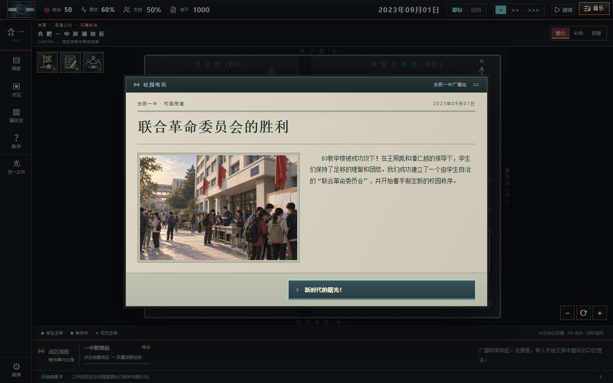
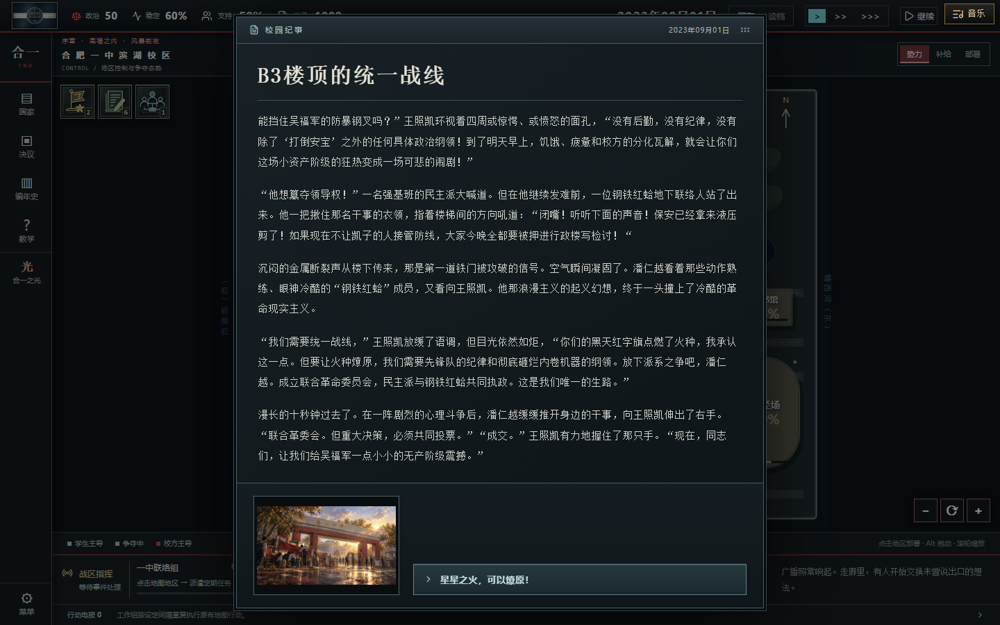

# 校园新闻配图 · 2026-10-11

为新闻弹窗单独制作六幅横向3:2插画。画面表达游戏中的虚构校园剧情，并非真实新闻照片。通过内置 `image_gen.imagegen` 生成；提示词、源文件哈希、尺寸和检测结果保存在 [manifest.json](manifest.json)。

| 图片 | 对应新闻 | 构图重点 |
| --- | --- | --- |
| school-opening | 新学期，新秩序 | 清晨校门、入校学生与值日教师 |
| committee-founded | 联合革命委员会的胜利 | 教学楼、红旗与学生联络登记 |
| assembly-vote | 法案通过！ | 礼堂中的学生代表举牌表决 |
| broadcast-seized | 校园广播站的新声音 | 校园播音室与收听广播的学生 |
| commercial-campus | 教育产业化的狂欢 | 食堂价目表、支付终端与承包管理人员 |
| entertainment-inauguration | 大统领的就职演说与路线开启 | 礼堂讲台、猫耳发箍与娱乐投影 |

## 生成与检查流程

1. 阅读实际新闻正文，提取时间、场所、参与者和发生的事；每幅图各用一条独立提示词。
2. 统一采用成熟校园纪实插画构图、自然人物比例和克制配色，明确排除画布织纹、颗粒、脏微纹理、过度锐化与低幼卡通。
3. 在原生1536×1024图片上运行 [repair-ai-image-quality](https://github.com/linsahdkadsa/repair-ai-image-quality) 的默认迷宫纹检测，强度60。逐幅检查完整构图；[overview.jpg](overview.jpg)提供全部画作预览。
4. 六幅图都判定「未检测到明显GPT迷宫纹」，`action=no-op`，分数分别为0.000372、0.000219、0.000291、0.001095、0.000185、0。没有强制滤波，也没有宣称跳过等于修复。清晰轮廓与物体纹理保留原样。
5. 输出1200×800 WebP，质量87；弹窗以完整3:2相框显示，`object-fit:contain`，避免照片被拉长或裁掉主体。六张网页图合计约0.78MiB。

本目录保留生成PNG及完整记录；网页实际使用 `src/assets/events/news` 中的WebP。新闻图不混入载入图抽取或美术室收藏，原有42幅CG及解锁规则继续使用。修复工具采用MIT许可；这些新图未使用第三方新闻照片。

## 实装效果

