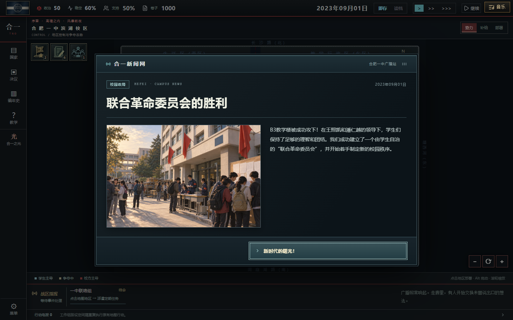
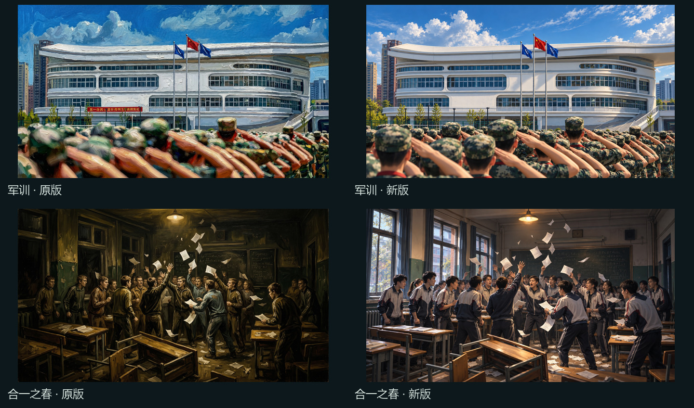
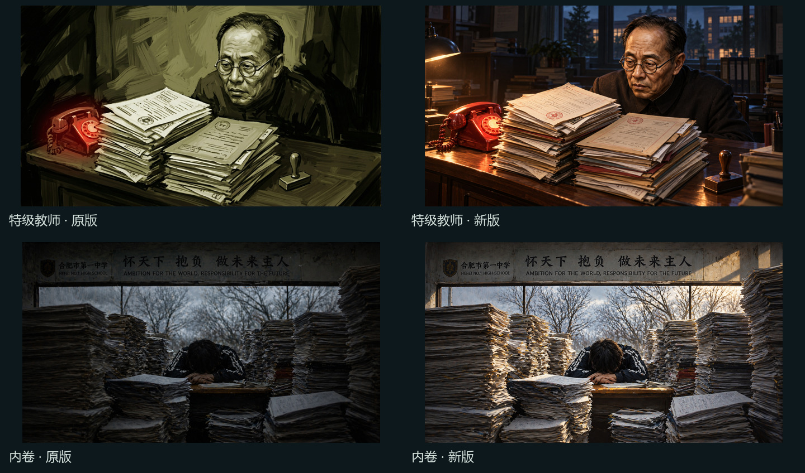
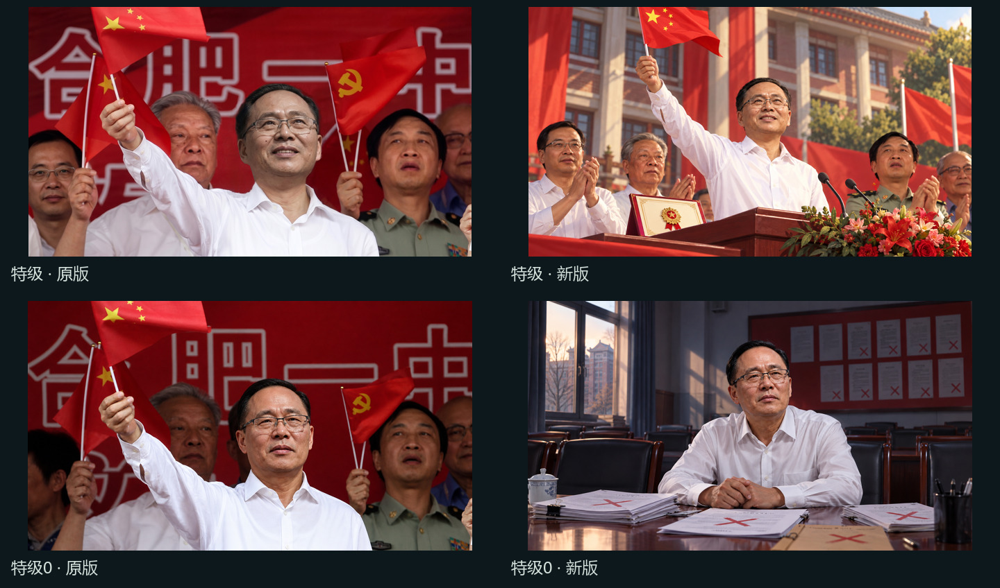
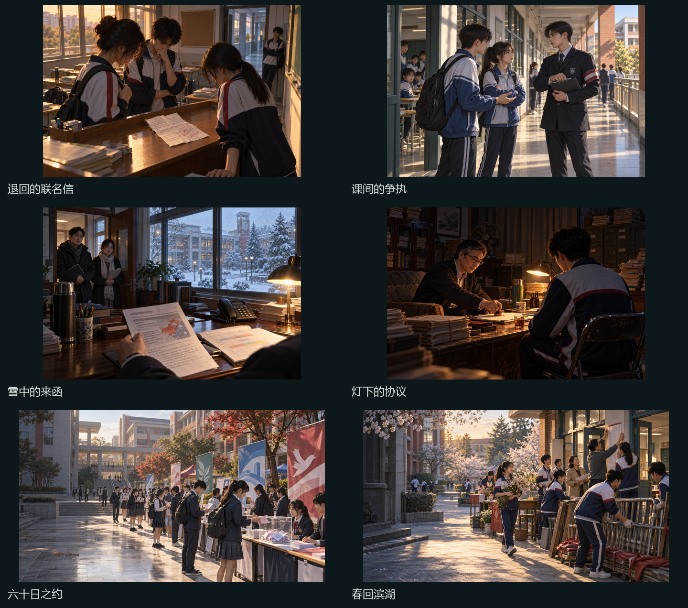
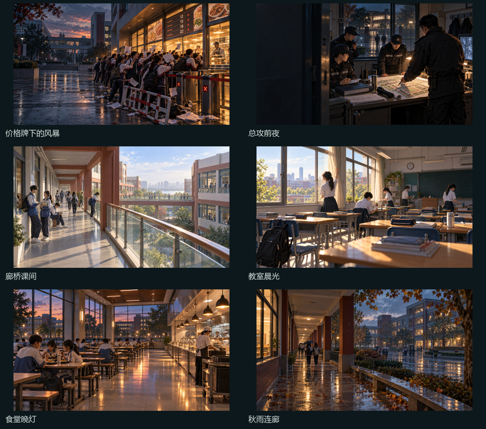

# 电子新闻与CG精修 · 2026-10-11

## 这次交付

旧图库42幅逐张审查：36幅保留，6幅重新绘制；新增12幅。现在图库54幅，其中11幅校园风景初始开放。原有未收录预览30%、已收录画作70%的载入规则保持不变。

新闻弹窗由纸色报刊改为深色电子新闻：枪灰底色、青蓝栏目细线、新闻网站刊头、栏目标签与发布日期，照片和正文分栏。栏目随校园政局、社团、经营、广播和议会等内容变化。小屏改为纵向阅读，照片完整显示；正文与多选项仍可分别滚动。超事件照片减少过度去色和暗化，标题遮罩继续保障阅读。

## 旧图修正

| 图片 | 修正重点 |
| --- | --- |
| 军训 | 教学楼窗格、队列、敬礼姿势与制服细节，去掉厚重油画笔触 |
| 合一之春 | 保留课堂争论与飞散纸张，统一校园服装、人物和室内光照 |
| 特级教师 | 保留人物辨识特征、红电话和文件堆，细化面部与办公桌，改善暗部 |
| 内卷 | 保留学生伏案与试卷压迫感，让纸张、衣褶和窗外冬景可辨 |
| 特级 | 统一人物与典礼的光照，减少头像拼贴感 |
| 特级0 | 保留人物辨识特征，改为评定失败后的空会议室，与成功图形成情境差异 |

黑白历史意象、及第城市梦境及狗熊路线涂鸦保持各自表达，不用统一滤镜覆盖路线差异。保留的36幅PNG已逐一核对原文件SHA256。

## 新CG与实装位置

| 图片 | 游戏用途与收录条件 |
| --- | --- |
| 退回的联名信 | 一阶段联名信被退回事件；实际经历该事件 |
| 课间的争执 | 一阶段课间扣分争执事件；实际经历该事件 |
| 雪中的来函 | 杨玉乐暴雪停课办公桌来件；实际处理该来件 |
| 灯下的协议 | 革委会“秘密妥协”事件；完成该国策或经历对应事件 |
| 六十日之约 | 首次民主普选开始事件及超事件；实际开启普选 |
| 春回滨湖 | 豪邦改革超事件；见证该超事件或对应结局 |
| 价格牌下的风暴 | 及第暴乱超事件；对应事件、国策或暴乱结局 |
| 总攻前夜 | 吴福军“总攻令”超事件；见证该超事件 |
| 廊桥课间 | 初始校园风景与载入CG |
| 教室晨光 | 初始校园风景与载入CG |
| 食堂晚灯 | 初始校园风景与载入CG |
| 秋雨连廊 | 初始校园风景与载入CG |

新事件画作不会仅因进入杨玉乐或序章路线就全部解锁。旧存档确认过事件的 `event_seen_*` 标记可证明对应画作已经历；旧美术室“已阅”记录仍不能代替剧情条件。实际收录仍跨局保存，事件阅读期间通知延后显示。

## 生成和质量处理

使用内置image_gen。要求精确结构、克制笔触、干净表面、清楚的暗部；避免厚画布、粗颗粒、低幼人物和大范围模糊。事件构图3:2；超事件与风景约16:9，超事件左侧预留标题空间。秘密妥协额外按原文校正为闭帘的旧档案室、两人密谈与盖章，删去不合剧情的第三人及握手。

18幅都在原尺寸下通过已安装的repair-ai-image-quality检测。四张事件图存在周期性网格，采用工具默认检测后的 `degrid` 清理；另外14幅未发现需要处理的系统缺陷，保留生成原图。没有强制磨平所有纹理，没有套用旧图全局校色。逐幅方法、检测结果、完整提示词、PNG及WebP哈希见 [manifest.json](manifest.json)；42幅旧图审查结果见 [old-cg-audit.json](old-cg-audit.json)。

PNG源图位于上级目录，网页使用 `src/assets/loading` 中的WebP。开发时运行 `scripts/build_loading_art.py` 可重建网页素材和目录；修图工具只在开发电脑使用，玩家与Cloudflare不需要Python或模型。原六张图可从Git提交66d1a4f恢复，本地也保存了 `.writing-work/cg-refresh/before` 备份。

## 验证

- 417个本地素材引用与Linux文件名大小写检查通过；类型检查、120项回归测试和生产构建通过。
- 独立浏览器成功解码54幅CG，验证11幅初始风景、四张事件与四张超事件的实际配图及收录限制；桌面与手机美术室、手机超事件均正常，无浏览器错误。
- 新闻/事件测试加载22次，检查桌面、平板、手机、横屏、多选项、长文、键盘焦点、拖动边界、菜单层级、照片后备和通知延后。
- 既有剧情正文、选项、效果、国策时长及路线推进代码保持原样。
