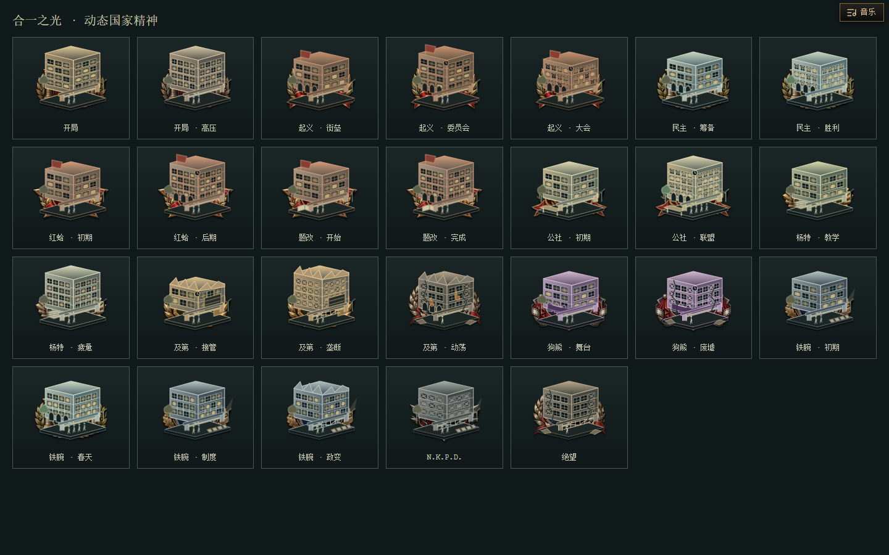
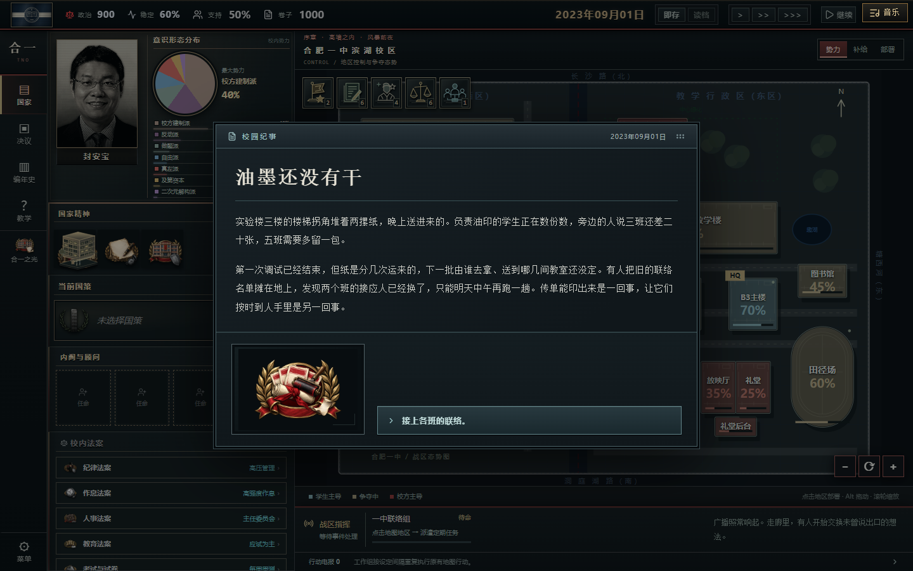

# v9.5.0 美术接入与验收

## 素材与绑定

- `route-art-v2` 为本轮提供的新素材来源。208条国策继续使用其独立绘画图标；不覆盖生成的 `routeIconArtwork.ts`。
- 33张高精度主体、37张附属徽记、11张路线底座导出为WebP。原画保留，透明主体按可见alpha裁边；源文件SHA-256、尺寸、导出路径与字节数在 `src/assets/campaign-art/receipts.json`。
- `scripts/art/link_campaign_events.ts` 静态分析国策完成回调，提取185条实际事件关联，不执行回调。独立场景CG、新闻配图与明确的人物肖像优先，其后采用关联国策的主体原画或组合徽记。未知存档事件继续使用原回退。
- 新徽记用于学生大会、题改、政治局、企业、六种小游戏、特色系统入口及决议标题。装饰图片不接管交互。
- 26个已实装结局的本地CG与9幅新增原图、提示词、质量检查分别见 `src/config/endingArtwork.ts` 和 `art/结局CG-2026-10-23`。

## 国策与精神

- 164×126的国策交互框保留，绘画区扩大为180×126，重要国策为192×132并轻微超出框体。标题、天数、状态和进行进度单独排布。
- `getFocusLayout` 只在图形可能相碰的列之间扩开距离，同列对齐与原始分支顺序保持；所有树的连接线使用同一坐标结果。
- 国家精神取消额外双层小框，以76×67的徽章排列；悬浮说明与法案入口仍在原位。
- 合一之光用独立SVG校园徽章，复用原场景的路线、章节、铁腕分支和合一值判定。教学楼、屋顶、窗型、拱廊、门禁、印刷与题册等道具、人流和破败程度构成差分。窗灯错峰缓变，戒严探照灯和动荡余火有独立动态；减少动态偏好会关闭动画。
- 徽章无按钮语义、无点击操作、不创建额外状态或增益；悬浮窗仍显示原有八个区域的动态介绍。

## 复核

- 144项测试、809处本地素材引用、版本一致性、TypeScript及生产构建通过；最大部署文件7.57 MiB。
- 独立浏览器解码368项本轮相关素材；实测国策启动、事件场景/肖像/绘画、学生大会、26个结局、桌面/紧凑/手机布局，无页面异常。
- 实测动态徽章的窗灯变化、点击无效果和减少动态模式。差分预览见下图。
- 手机结算时发现美术解锁通知会拦截按钮，已让通知正文穿透点击，保留关闭按钮可操作。
- 此批未更改路线门槛、剧情文本、资源效果、日期推进、工作组逻辑、存档格式和70/30载入预览规则；已核对路线指南。

## 后续更新顺序

1. 上游原画更新后运行 `scripts/art/build_campaign_art.py`；不要反向覆盖原图。
2. 国策与事件新增关联后运行 `npx tsx scripts/art/link_campaign_events.ts`，人工核对对应剧情。
3. 新结局CG保留源图与提示词，执行质量检查、WebP导出，再登记结局绑定和精确解锁条件。
4. 更新玩家版本与介绍，运行 `npm run check` 并实机查看实际尺寸和交互。
