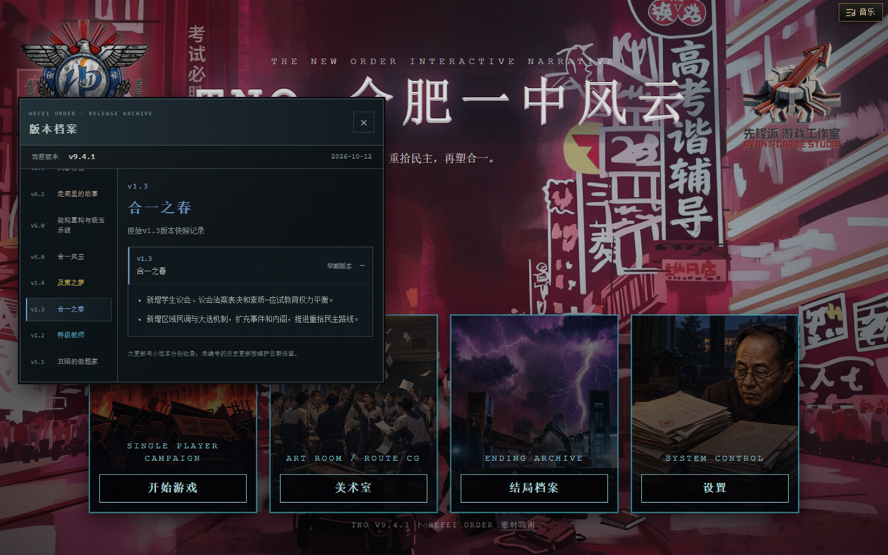
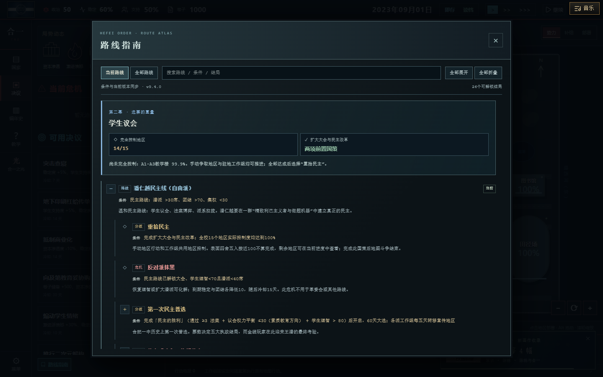

# 版本档案与路线指南维护

当前版本：v9.4.1「合一档案」，2026-10-12。

## 每次发布

1. 在`src/data/releaseHistory.json`首个大更新的`releases`前面添加小版本：唯一编号、标题、发布日期、玩家可理解的更新要点，并更新`currentVersion`。同一大更新继续使用9.4.1、9.4.2等编号。
2. 新的大更新建立新分组，例如9.5，填写名称、主题颜色与概述。旧组和原编号保留；既往没有编号的记录保留为按日期区分的维护批次。
3. 同步`package.json`、`package-lock.json`及锁文件根项目的版本。`CHANGELOG.md`添加`## v版本号 — 更新标题（日期）`。
4. 检查本次改动是否改变路线入口、国策条件、危机、法案、地区交互、工作组或结局；若有，同步`src/data/routeGuide.ts`和`src/engine/routeGuidance.ts`。
5. 运行`npm run check`。构建会校验版本一致性、编号重复、主题颜色和更新内容；指南测试核对关键条件与实际国策。

开始页悬浮提示、页脚和指南版本从同一份数据读取，无须逐处修改UI。早期主题名与编号依据`art/版本快照`原图转录，日期未能确认的保留为空，不给后期版本套用早期主题名称；原更新标题保留在展开记录中；Git提交曾使用的V2.x批次标签不替换原有玩家界面v5–v9编号。

## 路线指南

- 路线树保留已有剧情梗概和结局引用，条件单独核对；结局标题始终读取实际结局目录。
- 当前路线依据当前国策树选择，不用已离开的路线旗标选取指南。
- 实时地区进度复用地图的十五地块控制判定，99.9%不能误标为完成。
- 十字路口预判复用实际分流函数，说明真正在事件确认时判定。
- 新增路线树时，补充`currentGuideId`映射和当前进度说明。注意国策时间与危机时间不同，说明中需写明其来源。
- 当前窗口提供搜索、全部路线、分级展开、真正的全部折叠和独立阅读滚动。Esc只关闭指南，焦点回到原入口，不同时开启游戏设置菜单。

## 开始页交互

左上角游戏logo只在鼠标悬停时显示版本提示；点击展开同风格浮窗，无全屏遮罩，不捕获页面焦点，可用×关闭或在浮窗内部按Esc关闭。右上角工作室logo只在悬停时显示母校致谢。键盘焦点不会让两个提示保持显示。路线指南继续使用原有独立阅读窗口。

## 本轮范围

更新档案与致谢采用原有TNO深色金属风格。母校致谢暂定合肥一中；素材来源鸣谢继续保留原入口。此更新不调整事件正文、分流逻辑、数值收益或国策时长。

## 验证记录

v9.4.1：127项测试、420个本地素材引用、类型检查、版本一致性检查与生产构建通过。档案共27组、48条记录。独立浏览器核对左右logo位置、鼠标移开后提示隐藏（包括点击与键盘聚焦后）、无模态遮罩、四个主菜单按钮不被阻挡，以及档案打开时可直接打开设置。逐项核对v1.1–v1.4名称与内容展开，检查桌面和手机浮窗边界、关闭按钮，无浏览器错误。指南回归测试核对B3门槛、十字路口、十五地区实际控制和60天选举；此次未改指南交互。

